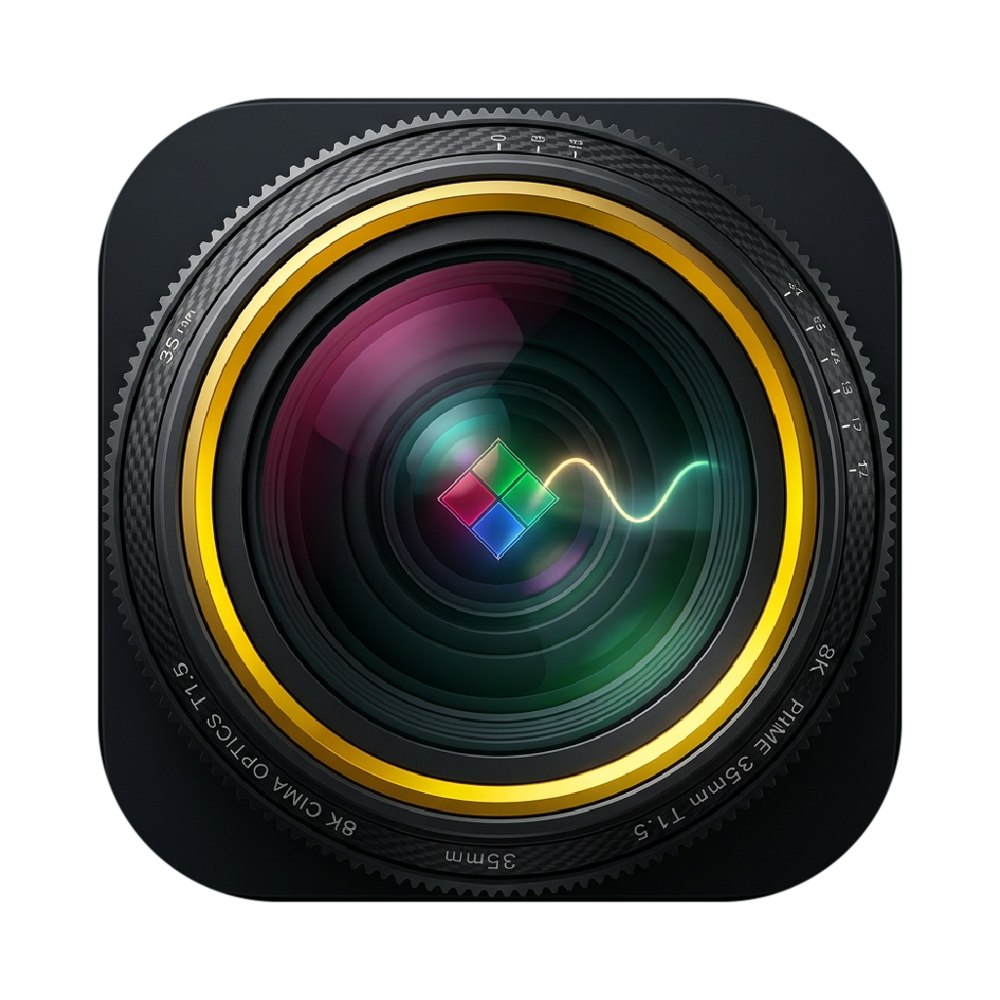

<p align="center">
  
</p>

<h1 align="center">nev2prores Studio</h1>

<p align="center">
  <b>Native macOS Apple Silicon Nikon N-RAW (<code>.nev</code>) to 12-Bit Apple ProRes 4444 / N-Log / Rec. 2020 Transcoder & Grading Studio</b>
</p>

---

## Overview

`nev2prores` is a native macOS (`aarch64-apple-darwin`) CLI and Studio GUI transcoder built in **Rust + Apple Metal Compute Shaders + Apple `VideoToolbox`**. It decodes Nikon Z8 / Z9 `.nev` (N-RAW / TicoRAW) video containers and transcodes them into **12-bit Apple ProRes 4444 (`ap4h`)** or **10-bit Apple ProRes 422 HQ (`apch`)** `.mov` files encoded in **Nikon N-Log / ITU-R BT.2020**, preserving full RAW-equivalent White Balance (Kelvin / Tint) and Exposure ($\Delta\text{EV}$) adjustments in scene-linear light prior to log encoding.

No FFmpeg subprocess wrappers are used.

---

## Architecture & Pipeline Stages

1. **Stage 1: Zero-Copy 64-Bit ISO-BMFF (`.nev`) Demuxer & Nikon `NCDT` MakerNote Parser (`src/demuxer.rs`, `src/metadata.rs`)**
   - 64-bit extended box parser (`size == 1` + 64-bit `largesize`) supporting >4 GB `.nev` containers.
   - Extracts video (`stsd`, `stts`, `stsc`, `stsz`, `co64`), 24-bit Linear PCM audio (`soun`), and camera SMPTE timecode (`tmcd`) tracks.
   - Scans `moov -> udta -> NCDT` for the embedded `"Nikon\0"` MakerNote TIFF header (`II` little-endian and `MM` big-endian) to extract **`0x000C` (`WB_RBLevels`)**, **`0x003D` (`BlackLevel`)**, ISO speed, shutter speed, and lens metadata.

2. **Stage 2: Multithreaded TicoRAW Bitstream Decoder (`src/decoder.rs`)**
   - Unpacks compressed `.nev` frames into 16-bit RGGB Bayer buffers (`Vec<u16>`) across Apple Silicon performance cores using `rayon` and a bounded `crossbeam_channel` ring buffer.

3. **Stage 3: Apple Metal GPU Debayer & Scene-Linear Color Pipeline (`src/metal_pipeline.rs`, `shaders/pipeline.metal`)**
   - Uses Apple Silicon Unified Memory (`MTLResourceOptions::StorageModeShared`) and `new_buffer_with_bytes_no_copy` for zero-copy GPU buffer sharing.
   - **Malvar-He-Cutler (5×5 edge-directed) RGGB Demosaicing** with parity-preserving border reflection and `--scale <full|half>` support.
   - **Scene-Linear RAW Grading**: Applies As-Shot WB gains, $2^{\Delta\text{EV}}$ exposure scaling, and the $3 \times 3$ **Bradford Chromatic Adaptation Matrix** $M_{\text{WB}}$ into ITU-R BT.2020.
   - **Exact Nikon N-Log Transfer Function Encoding** ($x_0 \approx 0.116597$).

4. **Stage 4: Hardware `VideoToolbox` ProRes 4444 / 422 HQ Encoder & FCPXML v1.11 Generator (`src/encoder.rs`, `src/fcpxml.rs`)**
   - Hardware `VTCompressionSession` encoding for `ap4h` (ProRes 4444) and `apch` (ProRes 422 HQ).
   - 64-bit QuickTime `.mov` muxer writing explicit `colr` (`nclc`: ITU-R BT.2020 primaries `9`, transfer `8`, matrix `9`), uncompressed 24-bit Linear PCM audio passthrough, and `tmcd` timecode passthrough.
   - Final Cut Pro **FCPXML v1.11** sidecar generator (`--fcpxml`).

---

## Quick Install (macOS `.dmg` / `.app`)

A pre-built macOS universal/Apple Silicon application bundle and disk image are included in [`dist/`](dist/):

- **Mount the Drag-and-Drop DMG Installer**:
  ```bash
  open dist/nev2prores.dmg
  ```
  Drag **`nev2prores.app`** onto **`Applications`**.

- **Or copy `dist/nev2prores.app` directly to `/Applications`**:
  ```bash
  cp -R dist/nev2prores.app /Applications/
  open /Applications/nev2prores.app
  ```

---

## CLI Usage

```bash
nev2prores \
  --input <FILE_OR_DIR> \
  --output <DIR> \
  --codec <prores4444|prores422hq> \
  --kelvin <OPTIONAL_TARGET_KELVIN> \
  --tint <OPTIONAL_TINT_SHIFT> \
  --ev <OPTIONAL_EXPOSURE_STOPS_FLOAT> \
  --scale <full|half> \
  --fcpxml \
  --inspect-only
```

### Generate a Synthetic 1080p 12-Bit Nikon Z9 `.nev` Sample & Transcode
```bash
cargo run --release --bin nev2prores -- \
  --generate-sample \
  --input ./sample_z9.nev \
  --output ./out \
  --codec prores4444 \
  --kelvin 5200 \
  --tint 2.0 \
  --ev 0.5 \
  --fcpxml
```

---

## Building from Source

```bash
# Run unit and end-to-end Metal + VideoToolbox tests
cargo test

# Rebuild dist/nev2prores.app and dist/nev2prores.dmg
./scripts/bundle_macos_app.sh
```
